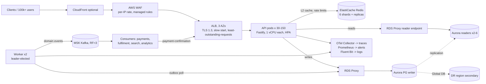

# Architecture

## Requirements that drive the design

| Requirement | Design consequence |
|---|---|
| 40,000 RPS peak, 100k+ concurrent users | Stateless API pods scaled horizontally; reads absorbed by cache and replicas |
| No oversell, no duplicate orders, no lost events | Stock invariants enforced in one Postgres transaction plus CHECK constraints; idempotency keys; transactional outbox |
| No cascading failure under spikes or dependency outages | Load shedding, circuit breakers, fail-fast timeouts, degradation paths per dependency |
| No single point of failure | 3 AZs for every tier; Aurora Multi-AZ + Global DB; Redis replicas; MSK RF=3; leader-elected worker |
| Predictable latency | Short transactions, keyset pagination, bounded pools, no work on the request path that can wait |

Traffic profile (e-commerce at peak): ~92% reads (catalog, availability, order status), ~8% checkouts.

## System diagram



## Code structure (clean architecture)

```
src/
  config/            env parsing + validation (fail fast, no hardcoded environment values)
  domain/            typed errors (no framework deps)
  infra/             db (pools, tx + retry, breakers), redis, cache, metrics, logger, tracing, retry, uuidv7
  http/              Fastify app, auth (JWT verify), rate limiter, load shedder, pagination
  modules/products/  repository (SQL) + service (business rules, cache, audit, outbox)
  modules/orders/    repository + service (checkout transaction, state machine)
  workers/           outbox relay (Kafka publisher, leader election)
  container.ts       composition root: the only place concrete infra is wired into services
  server.ts          API entrypoint, graceful shutdown
  worker.ts          background worker entrypoint
```

Dependencies point inward: HTTP → services → repositories → infra interfaces. Services take
their dependencies through constructors, which is how the integration tests run the real code
against real Postgres/Redis and swap in failing dependencies.

## Request path

1. **onRequest**: request ID (propagated or UUIDv7), load-shedding check, JWT verification
   (pinned algorithms, iss/aud/exp), token-bucket rate limit (Redis Lua; falls back to a
   per-process bucket if Redis is down).
2. **Validation**: zod strict schemas. Unknown fields are rejected, and clients cannot send prices.
3. **Service**: reads go through the cache to the read pool; writes go through a short
   transaction on the writer.
4. **onResponse**: RED metrics; sampled access log (all errors and slow requests, 1% of the rest).

## Checkout transaction

```
BEGIN
  INSERT idempotency_keys ... ON CONFLICT DO NOTHING   -- concurrent duplicate blocks, then replays the winner
  SELECT price, active FROM products WHERE id = ANY(...)  -- authoritative prices, never from cache
  INSERT orders; INSERT order_items (unnest); INSERT outbox (OrderCreated)
  WITH locked AS MATERIALIZED (SELECT ... ORDER BY product_id FOR UPDATE)
  UPDATE inventory SET available = available - qty, reserved = reserved + qty
   WHERE available >= qty                                -- shortfall => rollback everything
COMMIT
```

- Row locks are taken **last** and in **product_id order**: the shortest possible critical section
  for hot SKUs, and no lock-order deadlocks.
- Deadlocks and serialization failures (40P01/40001) retry the whole transaction with full-jitter backoff.
- Any failure rolls back the idempotency claim too, so the client can safely retry with the same key.

## Resilience matrix

| Failure | Behaviour | Mechanism |
|---|---|---|
| Traffic spike beyond capacity | Browse requests get 503 + Retry-After; checkout is protected; HPA + Karpenter add capacity | AIMD load shedder (event-loop delay / utilization), priority classes, in-flight cap |
| Redis down | Catalog served from Postgres; rate limiting becomes per-pod | Breakers around cache and limiter, fallback paths, no offline queue, 250 ms command timeout |
| Postgres reader / writer unavailable | Fast 503 (no hang, no pool pile-up); breaker opens; Aurora fails over in ~30 s; RDS Proxy holds connections | Connect/statement timeouts, breakers, retry only safe errors |
| Kafka down | Orders still accepted; events accumulate in the outbox and drain later | Transactional outbox, at-least-once relay, `OutboxLag` alert |
| Pod crash / node loss | ALB health checks remove it; PDB keeps 85% available during voluntary disruption | Readiness, topology spread, PDB |
| AZ loss | Capacity plan holds peak on 2 of 3 AZs | 1.5× AZ allowance, zone spread on every tier |
| Region loss | Promote the Aurora Global secondary; redeploy from IaC | RUNBOOK §Region failover (RPO ~1 s, RTO < 1 h) |
| Bad deploy | Canary aborts automatically on SLO breach; one-command rollback to an immutable tag | Argo Rollouts analysis, `cd.yml` rollback |

## Consistency model

- Stock, orders and payments: **strongly consistent** (single-writer transactions).
- Catalog display: eventually consistent, ≤ 1 s (L1) / invalidated (L2, 300 s TTL backstop).
- Order reads go to a replica first, then fall back to the writer on a miss, so you always read your own write.
- Events: at-least-once, ordered per aggregate (single relay leader, Kafka key = aggregate id).
  Consumers dedupe on `event-id`.
